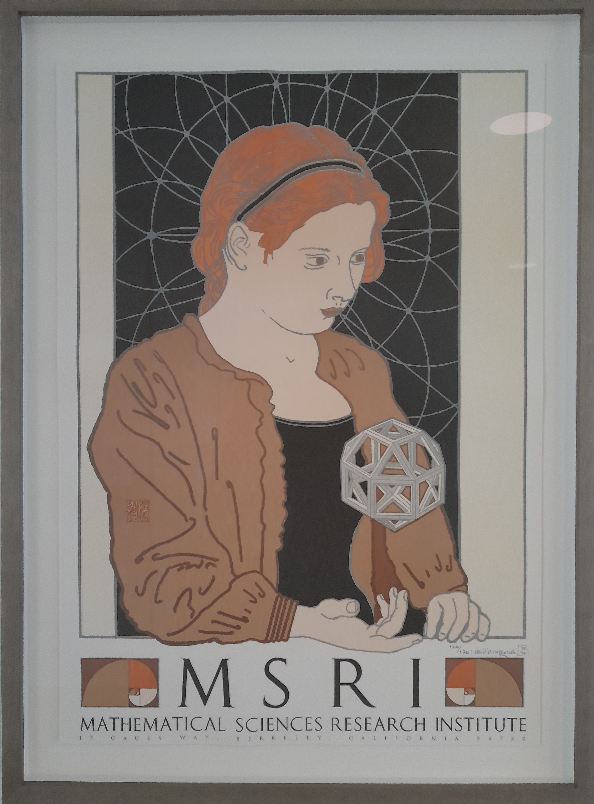

<html>
<head>
<title>
Sylvy Anscombe
</title>
</head>

<body>

My research interests lie in <a href="https://en.wikipedia.org/wiki/Model_theory">Model Theory</a>, a part of <a href="https://en.wikipedia.org/wiki/Mathematical_logic">Mathematical Logic</a>, including connections to algebra and number theory.

  

<h3>publications</h3>

<h5>submitted/notes</h5>
<ol reversed class="papers" type="a">

<li value="3">
<a class="linklight">Notes on tame valued fields</a>.
 
Manuscript, 2026.
    <a class="linkresearchlight" href="/backpages/2026-11-04-tame.html">pdf</a>
</li>

<li value="2">
<a class="linklight">Elimination results for tame fields with finite residue fields</a>,
with Blaise Boissonneau.
 
Submitted, 2026.
<!--

<a class="linkresearchdetails">links</a>

-->
    <a class="linkresearchlight" href="https://arxiv.org/abs/2604.26129">arXiv:2604.26129 [math.LO]</a>
</li>

<li value="1">
<a class="linklight">On lambda functions in henselian and separably tame valued fields</a>.
 
Submitted, 2025.
<!--

<a class="linkresearchdetails">links</a>

-->
    <a class="linkresearchlight" href="https://arxiv.org/abs/2505.07518">arXiv:2505.07518 [math.LO]</a>
</li>

</ol>

<h5>research articles</h5>
<ol reversed class="papers">

<li value="18">
<a class="linklight">Multidimensional asymptotic classes</a>,
with Dugald Macpherson, Charles Steinhorn, and Daniel Wolf.
 
To appear in <i>Transactions of the American Mathematical Society</i>, 2026.
<!--

<a class="linkresearchdetails">links</a>

-->
<a class="linkresearchlight" href="https://arxiv.org/abs/2408.00102">arXiv:2408.00102 [math.LO]</a>
</li>

<li value="17">
<a class="linklight">Existential fragments of theories of henselian valued fields</a>,
with Arno Fehm.
 
<i>Zeitschrift für Mathematische Logik und Grundlagen der Mathematik</i>, 72:445&ndash;456, 2026.

<a class="linkresearchdetails">links</a>

    <a class="linkresearchlight" href="http://arxiv.org/abs/2601.17395">arXiv:2601.17395 [math.LO]</a>
    <a class="linkresearchlight" href="https://doi.org/10.60866/CAM.325">doi:10.60866/CAM.325</a>

</li>

<li value="16">
<a class="linklight">Interpretations of syntactic fragments of theories of fields</a>,
with Arno Fehm.
 
<i>Israel Journal of Mathematics</i>, 2026.

<a class="linkresearchdetails">links</a>

    <a class="linkresearchlight" href="http://arxiv.org/abs/2312.17616">arXiv:2312.17616 [math.LO]</a>
    <a class="linkresearchlight" href="https://doi.org/10.1007/s11856-026-2938-z">doi:10.1007/s11856-026-2938-z</a>

</li>

<li>
<a class="linklight">One-dimensional $F$-definable sets in $F(\!(t)\!)$</a>.
 
<i>Journal of Algebra</i>, 687 (2026) 731&ndash;742.
<!--
-->

<a class="linkresearchdetails">links</a>

    <a class="linkresearchlight" href="https://arxiv.org/abs/1503.05803">arXiv:1503.05803 [math.LO]</a>
    <a class="linkresearchlight" href="https://hal.science/hal-05292948">hal-05292948</a>
    <a class="linkresearchlight" href="https://doi.org/10.1016/j.jalgebra.2025.09.005">doi:10.1016/j.jalgebra.2025.09.005</a>

</li>

<li>
<a class="linklight">Universal-existential theories of fields</a>,
with Arno Fehm.
 
<i>Proceedings of the Edinburgh Mathematical Society</i>, 69(1):95&ndash;124, 2026.
<!--
-->

<a class="linkresearchdetails">links</a>

    <a class="linkresearchlight" href="https://arxiv.org/abs/2405.12771">arXiv:2405.12771 [math.LO]</a>
    <a class="linkresearchlight" href="https://hal.science/hal-05344752">hal-05344752</a>
    <a class="linkresearchlight" href="https://doi.org/10.1017/S0013091525100771">doi:10.1017/S0013091525100771</a>

</li>

<li>
<a class="linklight">Ax&ndash;Kochen&ndash;Ershov principles for finitely ramified henselian fields</a>,
with Philip Dittmann and Franziska Jahnke.
 
<i>Transactions of the American Mathematical Society</i>, 377-12:8963&ndash;8988, 2024.
<!--
-->

<a class="linkresearchdetails">links</a>

    <a class="linkresearchlight" href="https://arxiv.org/abs/2305.12145">arXiv:2305.12145 [math.LO]</a>
    <a class="linkresearchlight" href="https://hal.science/hal-05158062">hal-05158062</a>
    <a class="linkresearchlight" href="https://doi.org/10.1090/tran/9271">doi:10.1090/tran/9271</a>

</li>

<li>
<a class="linklight">Characterizing NIP henselian fields</a>,
with Franziska Jahnke.
 
<i>Journal of the London Mathematical Society</i>, 109(3), 2024.

<!--
-->

<a class="linkresearchdetails">links</a>

    <a class="linkresearchlight" href="https://arxiv.org/abs/1911.00309">arXiv:1911.00309 [math.LO]</a>
    <a class="linkresearchlight" href="https://hal.science/hal-05158057">hal-05158057</a>
    <a class="linkresearchlight" href="https://doi.org/10.1112/jlms.12868">doi:10.1112/jlms.12868</a>

</li>

<li>
<a class="linklight">Axiomatizing the existential theory of $\mathbb{F}_{q}(\!(t)\!)$</a>,
with Philip Dittmann and Arno Fehm.
 
<i>Algebra &amp; Number Theory</i>, 17-11:2013&ndash;2032, 2023.
<!--
-->

<a class="linkresearchdetails">links</a>

    <a class="linkresearchlight" href="https://arxiv.org/abs/2205.05438">arXiv:2205.05438 [math.LO]</a>
    <a class="linkresearchlight" href="https://hal.science/hal-05158056">hal-05158056</a>
    <a class="linkresearchlight" href="https://doi.org/10.2140/ant.2023.17.2013">doi:10.2140/ant.2023.17.2013</a>

</li>

<li>
<a class="linklight">The model theory of Cohen rings</a>,
with Franziska Jahnke.
 
<i>Confluentes Mathematici</i>, 14, no. 2, 1&ndash;28, 2022.
<!--
-->

<a class="linkresearchdetails">links</a>

    <a class="linkresearchlight" href="https://arxiv.org/abs/1904.08297">arXiv:1904.08297 [math.LO]</a>
    <a class="linkresearchlight" href="https://hal.science/hal-05158048">hal-05158048</a>
    <a class="linkresearchlight" href="https://doi.org/10.5802/cml.84">doi:10.5802/cml.84</a>

</li>

<li>
<a class="linklight">Denseness results in the theory of algebraic fields</a>,
with Philip Dittmann and Arno Fehm.
 
<i>Annals of Pure and Applied Logic</i>, 172(8):102973, 2021.
<!--
-->

<a class="linkresearchdetails">links</a>

    <a class="linkresearchlight" href="https://arxiv.org/abs/1909.12188">arXiv:1909.12188 [math.LO]</a>
    <a class="linkresearchlight" href="https://doi.org/10.1016/j.apal.2021.102973">doi:10.1016/j.apal.2021.102973</a>

</li>

<li>
<a class="linklight">A $p$-adic analogue of Siegel's theorem on sums of squares</a>,
with Philip Dittmann and Arno Fehm.
 
<i>Mathematische Nachrichten</i>, 293:1434&ndash;1451, 2020.
<!--
-->

<a class="linkresearchdetails">links</a>

    <a class="linkresearchlight" href="https://arxiv.org/abs/1904.03466">arXiv:1904.03466 [math.NT]</a>
    <a class="linkresearchlight" href="https://doi.org/10.1002/mana.201900173">doi:10.1002/mana.201900173</a>

</li>

<li>
<a class="linklight">Approximation theorems for spaces of localities</a>,
with Philip Dittmann and Arno Fehm.
 
<i>Mathematische Zeitschrift</i>, 296:1471&ndash;1499, 2020.
<!--
-->

<a class="linkresearchdetails">links</a>

    <a class="linkresearchlight" href="https://arxiv.org/abs/1901.02632">arXiv:1901.02632 [math.AC]</a>
    <a class="linkresearchlight" href="https://doi.org/10.1007/s00209-020-02516-6">doi:10.1007/s00209-020-02516-6</a>

</li>

<li>
<a class="linklight">Existentially generated subfields of large fields</a>.
 
<i>Journal of Algebra</i>, 517C:78&ndash;94, 2019.
<!--
-->

<a class="linkresearchdetails">links</a>

    <a class="linkresearchlight" href="https://arxiv.org/abs/1710.03353">arXiv:1710.03353 [math.LO]</a>
    <a class="linkresearchlight" href="https://dx.doi.org/10.1016/j.jalgebra.2018.09.021">doi:10.1016/j.jalgebra.2018.09.021</a>

</li>

<li>
<a class="linklight">Henselianity in the language of rings</a>,
with Franziska Jahnke.
 
<i>Annals of Pure and Applied Logic</i>, 169(9):872&ndash;895, 2018.
<!--
-->

<a class="linkresearchdetails">links</a>

    <a class="linkresearchlight" href="https://arxiv.org/abs/1512.04588">arXiv:1512.04588 [math.LO]</a>
    <a class="linkresearchlight" href="https://dx.doi.org/10.1016/j.apal.2018.04.008">doi:j.apal.2018.04.008</a>

</li>

<li>
<a class="linklight">Characterizing diophantine henselian valuation rings and valuation ideals</a>,
with Arno Fehm.
 
<i>Proceedings of the London Mathematical Society</i>, 115:293&ndash;322, 2017.
<!--
-->

<a class="linkresearchdetails">links</a>

    <a class="linkresearchlight" href="https://arxiv.org/abs/1602.01233">arXiv:1602.01233 [math.LO]</a>
    <a class="linkresearchlight" href="https://dx.doi.org/10.1112/plms.12042">doi:10.1112/plms.12042</a>

</li>

<li>
<a class="linklight">Notes on extremal and tame valued fields</a>,
with Franz-Viktor Kuhlmann.
 
<i>Journal of Symbolic Logic</i>, 81:400&ndash;416, 2016.
<!--
-->

<a class="linkresearchdetails">links</a>

    <a class="linkresearchlight" href="https://arxiv.org/abs/1407.3759">arXiv:1407.3759 [math.LO]</a>
    <a class="linkresearchlight" href="https://dx.doi.org/10.1017/jsl.2016.6">doi:10.1017/jsl.2016.6</a>

</li>

<li>
<a class="linklight">The existential theory of equicharacteristic henselian valued fields</a>,
with Arno Fehm.
 
<i>Algebra &amp; Number Theory</i>, 10-3:665&ndash;683, 2016.
<!--
-->

<a class="linkresearchdetails">links</a>

    <a class="linkresearchlight" href="https://arxiv.org/abs/1501.04522">arXiv:1501.04522 [math.LO]</a>
    <a class="linkresearchlight" href="https://dx.doi.org/10.2140/ant.2016.10.665">doi:10.2140/ant.2016.10.665</a>

</li>

<li>
<a class="linklight">An existential $\emptyset$-definition of $\mathbb{F}_{q}[\![t]\!]$ in $\mathbb{F}_{q}(\!(t)\!)$</a>,
with Jochen Koenigsmann.
 
<i>Journal of Symbolic Logic</i>, 79:1336&ndash;1343, 2014.
<!--
-->

<a class="linkresearchdetails">links</a>

    <a class="linkresearchlight" href="https://arxiv.org/abs/1306.6760">arXiv:1306.6760 [math.LO]</a>
    <a class="linkresearchlight" href="https://dx.doi.org/10.1017/jsl.2014.27">doi:10.1017/jsl.2014.27</a>

</li>

</ol>

<h5>other publications</h5>
<ol reversed class="papers" type="i"> 

<li value="6">
<a class="linklight">A note on existentially t-henselian fields</a>.
 
To appear in proceedings of conference DDG40.
    <a class="linkresearchlight" href="https://arxiv.org/abs/2603.27612">arXiv:2603.27612 [math.LO]</a>
<!--

<a class="linkresearchdetails">links</a>

-->
</li>

<li value="5">
<a class="linklight">Exposé Bourbaki 1246 : The model theory of perfectoid fields [after Jahnke and Kartas]</a>.
 
Séminaire Bourbaki, volume 2025/2026.
To appear.

<a class="linkresearchdetails">links</a>

    <a class="linkresearchlight" href="https://arxiv.org/abs/2602.23779">arXiv:2602.23779 [math.LO]</a>
    <a class="linkresearchlight" href="https://www.carmin.tv/en/video/1246-the-model-theory-of-perfectoid-fields">video</a>
<!--
, exposés 1246-12??.
<i>Astérisque</i>, no.438, p. 247&ndash;279, 2022.
    <a class="linkresearchlight" href="https://hal.science/hal-????????">hal-????????</a>
    <a class="linkresearchlight" href="https://doi.org/10.?????/ast.????">doi:10.?????/ast.????</a>
-->

</li>

<li value="4">
<a class="linklight">The unknown logic of power series</a>.
 
<i>Notices of the American Mathematical Society</i>, 71(11):1448&ndash;1455, 2024.
<!--
-->

<a class="linkresearchdetails">links</a>

    <a class="linkresearchlight" href="https://hal.science/hal-05158080v1">hal-05158080v1</a>
    <a class="linkresearchlight" href="https://doi.org/10.1090/noti3081">doi:10.1090/noti3081</a>

</li>

<li>
<a class="linklight">A survey of local-global methods for Hilbert's Tenth Problem</a>,
with Valentijn Karemaker, Zeynep Kisakürek, Vlerë Mehmeti, Margherita Pagano, and Laura Paladino.
 
<i>Women in Numbers Europe IV</i>, 
edited by Ramla Abdellatif, Valentijn Karemaker, and Lejla Smajlovic.
Assoc. Women Math. Ser., 32, 29--61, Springer, Cham, 2024.
<!--
-->

<a class="linkresearchdetails">links</a>

    <a class="linkresearchlight" href="https://hal.science/hal-05472571">hal-05472571</a>
    <a class="linkresearchlight" href="https://doi.org/10.1007/978-3-031-52163-8_2">doi:10.1007/978-3-031-52163-8_2</a>

</li>

<li>
<a class="linklight">Imperfection in NIP fields</a>,
with Franziska Jahnke.
 
Extended abstract, <i>Oberwolfach Reports</i> (20) 2023, pp. 125&ndash;127.
<!--
-->

<a class="linkresearchdetails">links</a>

    <a class="linkresearchlight" href="http://dx.doi.org/10.4171/OWR/2023/2">doi:10.4171/OWR/2023/2</a>

</li>

<li>
<a class="linklight">Exposé Bourbaki 1186 : Shelah’s Conjecture and Johnson’s Theorem [after Will Johnson]</a>.
 
Séminaire Bourbaki, volume 2021/2022, exposés 1181-1196.
<i>Astérisque</i>, no.438, p. 247&ndash;279, 2022.
<!--
-->

<a class="linkresearchdetails">links</a>

    <a class="linkresearchlight" href="https://hal.science/hal-05158075">hal-05158075</a>
    <a class="linkresearchlight" href="https://doi.org/10.24033/ast.1187">doi:10.24033/ast.1187</a>

</li>

</ol>

<h5>theses</h5>
<ol reversed class="papers" type="I">

<li value="2">
<a class="linklight">Axiomatisabilité et décidabilité de corps valués henséliens</a>.
HDR Mémoire, Université Paris Cité, 2026.

<a class="linkresearchdetails">links</a>

    <a class="linkresearchlight" href="https://hal.science/tel-05477988">tel-05477988</a>
    <a class="linkresearchlight" href="./backpages/Sylvy_HDR_SOUTENANCE_January_2026.pdf">slides</a>

</li>

<li value="1">
<a class="linklight">Definability in Henselian Fields</a>.
DPhil Thesis, University of Oxford, 2013.
 
Supervised by Prof. Jochen Koenigsmann.

<a class="linkresearchdetails">links</a>

    <a class="linkresearchlight" href="https://ora.ox.ac.uk/objects/uuid:65eec6d9-457d-4673-80de-6413865a6a46">ora:65eec6d9-457d-4673-80de-6413865a6a46</a>

</li>

</ol>

 

<h3>research team</h3>

Postdoc
<ul>
<li><a href="https://vincentbagayoko.neocities.org/">Vincent Bagayoko</a> (2025 &ndash;).
    ANR-DFG project with Franziska Jahnke, Münster.
</li>
</ul>

PhD
<ul>
<li>
    <a href="https://xietianyiwa.github.io/">Tianyiwa Xie</a> (2025 &ndash;).
    Co-supervised with Franziska Jahnke, Münster.
</li>
<li>
    <a href="https://paulosotomo.github.io/">Paulo Andrés Soto Moreno</a>.
        <i>The Independence Property and Valued Fields of Positive Characteristic</i>,
        2022&ndash;2026.
        <a class="linkresearchmain" href="./backpages/2025-07-14-Paulo.html">Paulo's papers</a>
</li>
<!--
<li>
    <a href="https://tu-dresden.de/mn/math/algebra/das-institut/beschaeftigte/piotr-szewczyk">Piotr Szewczyk</a> (2021 &ndash;).
    Co-supervised with Arno Fehm, TU Dresden.
<a class="linkresearchmain" href="./backpages/2025-07-14-Piotr.html">Piotr's papers</a>
</li>
-->
</ul>

Master/M&eacute;moire
<ul>
    <li><a href="https://solsantoyo-math.github.io/">Sol Susana Santoyo Olivera</a>.
        Current student, co-supervised with <a href="https://math.uniandes.edu.co/~p.cubideskovacsics/">Pablo Cubides Kovacsics</a>,
        2026.
    </li>
    <li>Mahsa Yadegari Khozani.
        <i>Non-definability of rings of integers</i>,
        current student,
        2026.
    </li>
    <li>Xiaorui Yin.
        <i>Globally valued fields</i>,
        mémoire de M2,
        2026.
    </li>
    <li>Julie Plessis.
        <i>Power series with cross-sections</i>,
        current student,
        2026.
    </li>
    <li>Fares Arous.
        <i>Separably algebraically maximal fields</i>,
        current student,
        2026.
    </li>
    <li>Thibaud Oiffer.
        <i>Measure and dimension in pseudofinite fields</i>,
        mémoire de M1,
        2026.
    </li>
    <li>Fares Arous.
        <i>Corps de Kaplansky très minces</i>,
        mémoire de M1,
        2025.
    </li>
    <li>Fares Arous.
        <i>Théorie des modèles du graphe de Rado</i>,
        stage de L3,
        2024.
    </li>
    <li>Nolwen Chabaud.
        <i>Théorie des modèles des corps valués</i>,
        mémoire de M1,
        2023.
    </li>
    <li>Julien Delteil.
        <i>Théorie des modèles des corps finis</i>,
        stage de L3,
        2023.
    </li>
    <li><a href="https://paulosotomo.github.io/">Paulo Andrés Soto Moreno</a>.
        <i>Inflators and diffeo-valued fields</i>,
        mémoire de M2,
        2022.
    </li>
</ul>

If you're interested in studying with me, please <a class="linkmain" href="/contact.html">contact me</a>.

  

<h3>editorial work</h3>

Currently serving as editor of

<ul>

<li><a class="linkresearchmain" href="https://msp.org/mt">Model Theory</a></li>

<li><a class="linkresearchmain" href="https://www.cambridge.org/core/journals/journal-of-symbolic-logic">Journal of Symbolic Logic</a></li>

</ul>

 

<h3>selected talks</h3>



 

<h3>meetings organized</h3>



 

<h3>useful links</h3>

<ul>

<li>journals

<ul>

    <li><a class="linkresearchmain" href="https://msp.org/mt">Model Theory &ndash; journal</a></li>

    <li><a class="linkresearchmain" href="https://www.cambridge.org/core/journals/journal-of-symbolic-logic">Journal of Symbolic Logic</a></li>

</ul>

</li>

<li>seminars

<ul>

    <li><a class="linkseminarmain" href="https://www.imj-prg.fr/gestion/evenement/affEvenement/66">S&eacute;minaire G&eacute;n&eacute;ral de Logique</a></li>

    <li><a class="linkseminarmain" href="https://gtm.imj-prg.fr/">G&eacute;om&eacute;trie et Th&eacute;orie des Mod&egrave;les</a></li>

    <li><a class="linkseminarmain" href="https://www.imj-prg.fr/gestion/evenement/affEvenement/71">Séminaire Théorie des modèles et groupes</a></li>

    <li><a class="linkseminarmain" href="https://semsao.imj-prg.fr/">Séminaire structures algébriques ordonnées</a></li>

</ul>

</li>

<li>my pages on 

	<ul>

	<li><a href="http://arxiv.org/a/anscombe_w_1">arXiv</a></li>

	<li><a href="http://orcid.org/0000-0002-9930-2804">ORCiD</a>: 0000-0002-9930-2804</li>

	<li><a href="https://scholar.google.co.uk/citations?user=WP2b3cMAAAAJ&hl=en">Google Scholar</a></li>

	<li><a href="https://uclan.academia.edu/SylvyAnscombe">academia.edu</a></li>

	<li><a href="https://genealogy.math.ndsu.nodak.edu/id.php?id=173503">Mathematics Genealogy Project</a></li>

	</ul>

</li>

<li><a href="https://u-paris.fr/">Université Paris Cité</a>

	<ul>

	<li><a href="https://www.imj-prg.fr/lm/">Équipe de Logique</a></li>

	<li><a href="https://www.imj-prg.fr/">IMJ-PRG</a></li>

	<li><a href="https://www.math.univ-paris-diderot.fr/">UFR de mathématiques</a></li>

	<li><a href="https://www.math.univ-paris-diderot.fr/formations/doctorats/index">École Doctorale 386 Sciences Mathématiques de Paris Centre</a></li>

	</ul> 

</li>

<li>other institutions

	<ul>

	<li><a href="http://www.star.uclan.ac.uk/">Jeremiah Horrocks Institute</a>, <a href="https://www.uclan.ac.uk/">University of Central Lancashire</a></li>

	<li><a href="https://eps.leeds.ac.uk/maths-pure-mathematics/doc/logic">Logic group</a>, <a href="https://eps.leeds.ac.uk/maths">School of Mathematics</a>, <a href="https://www.leeds.ac.uk/">University of Leeds</a></li>

	<li><a href="http://www.maths.ox.ac.uk/groups/logic">Mathematical Logic group</a>, <a href="http://www.maths.ox.ac.uk">The Mathematical Institute</a>, <a href="http://www.ox.ac.uk">University of Oxford</a></li>

	</ul>

</li>

<li>professional organisations

	<ul>

	<li><a href="http://www.lms.ac.uk">The London Mathematical Society</a></li>

	<li><a href="http://blc-logic.org">The British Logic Colloquium</a></li>

	<li><a href="https://aslonline.org">The Association for Symbolic Logic</a></li>

	</ul>

</li>

<li>online resources

	<ul>

	<li><a href="http://arxiv.org/">arXiv</a></li>

	<li><a href="http://www.ams.org/mathscinet/index.html">MathSciNet</a></li>

	<li><a href="https://modnet.imj-prg.fr/Meetings%20and%20events/">MODNET</a></li>

	<li><a href="https://oeis.org/">OEIS</a></li>

	<li><a href="https://www.lmfdb.org/">LMFDB</a></li>

	<li><a href="https://www.forkinganddividing.com/">forkinganddividing</a></li>

	<li><a href="https://mathscinet.ams.org/mathscinet/freetools/collab-dist">AMS Collaboration Distance</a></li>

	<li><a href="https://genealogy.math.ndsu.nodak.edu/index.php">Mathematics Genealogy Project</a></li>

	<li><a href="https://modnet.imj-prg.fr/seminars/">Online seminars in model theory</a></li>

	<li><a href="https://researchseminars.org/">Online mathematics research seminars</a></li>

	<li><a href="http://www.e-booksdirectory.com/mathematics.php">Free Mathematics ebooks</a></li>

	</ul>

</li>

</ul>

</body>
</html>
